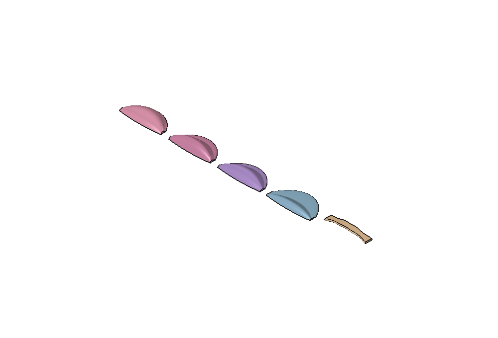

# LaLume HeadSpa – Lash Lift 3D Printing Training Kit

Parametric FreeCAD models for demonstrating and practicing lash lift techniques (**Prusa CORE One** ready).

> **Tip:** Click any **`.stl`** link below to open GitHub's **interactive 3D viewer** right in your browser. Use the **`.step`** files for maximum curve precision in PrusaSlicer.

---

## Visual Overview

| Lashes (TPU + Split PLA) | 5 Giant Shields (5.5×) |
| :---: | :---: |
|  |  |

| Shield Elevation Profiles | 2-Part Silicone Casting Mold |
| :---: | :---: |
|  |  |

---

## Models (Interactive 3D Preview & STEP Downloads)

### 1. Enlarged Lash Models (`120 mm` C-curl, `12.0 → 1.5 mm`)
| Part | Interactive 3D View (GitHub) | Precision Slicing | Notes |
| :--- | :---: | :---: | :--- |
| Flexible Lash (TPU) | [Lash_Flexible_TPU.stl](stl/Lash_Flexible_TPU.stl) | [Lash_Flexible_TPU.step](step/Lash_Flexible_TPU.step) | `2.4 mm` internal wire channel (`≥ 1.2 mm` wall) for `2.0 mm` aluminum/copper wire |
| Split Lash Half A (Matte PLA) | [Lash_Solid_Half_A.stl](stl/Lash_Solid_Half_A.stl) | [Lash_Solid_Half_A.step](step/Lash_Solid_Half_A.step) | 3 × `1.85 mm` alignment pin holes for `1.75 mm` filament pins |
| Split Lash Half B (Matte PLA) | [Lash_Solid_Half_B.stl](stl/Lash_Solid_Half_B.stl) | [Lash_Solid_Half_B.step](step/Lash_Solid_Half_B.step) | Mirror half, support-free flat print |

### 2. Giant 5.5× Lash Lift Shields (Flat-Backed, Support-Free)
| Profile | Interactive 3D View (GitHub) | Precision Slicing | Dimensions (mm) |
| :--- | :---: | :---: | :--- |
| Classic Round (C-curl) | [Shield_Round.stl](stl/Shield_Round.stl) | [Shield_Round.step](step/Shield_Round.step) | `166.6 × 80.0 × 28.0` |
| Teardrop (D-curl) | [Shield_Teardrop.stl](stl/Shield_Teardrop.stl) | [Shield_Teardrop.step](step/Shield_Teardrop.step) | `166.6 × 85.0 × 32.0` |
| Hybrid / Anatomical | [Shield_Hybrid.stl](stl/Shield_Hybrid.stl) | [Shield_Hybrid.step](step/Shield_Hybrid.step) | `171.5 × 85.0 × 26.0` |
| Flat (Korean Step 1 / L-curl) | [Shield_Flat_Korean.stl](stl/Shield_Flat_Korean.stl) | [Shield_Flat_Korean.step](step/Shield_Flat_Korean.step) | `176.4 × 95.0 × 18.0` |
| Compensator Strip | [Shield_Compensator.stl](stl/Shield_Compensator.stl) | [Shield_Compensator.step](step/Shield_Compensator.step) | `165.0 × 30.0 × 17.0` |

### 3. 2-Part PLA Silicone Casting Mold (Hybrid Shield)
| Part | Interactive 3D View (GitHub) | Precision Slicing | Notes |
| :--- | :---: | :---: | :--- |
| Mold Part A (Cavity) | [Shield_Mold_PartA.stl](stl/Shield_Mold_PartA.stl) | [Shield_Mold_PartA.step](step/Shield_Mold_PartA.step) | 4 key recesses (`6.2 mm`), `8 mm` pour funnel, 2 × `2.5 mm` air vents |
| Mold Part B (Flat Lid) | [Shield_Mold_PartB.stl](stl/Shield_Mold_PartB.stl) | [Shield_Mold_PartB.step](step/Shield_Mold_PartB.step) | 4 hemispherical alignment keys (`6.0 mm`) + matching channels |

---

## Parametric CAD Source
- [LaLume_Lash_Training_Kit.FCStd](cad/LaLume_Lash_Training_Kit.FCStd) (FreeCAD 1.1.4 document with `Parameters` spreadsheet)
- [generate_models.py](cad/generate_models.py) (parametric FreeCAD Python generator)

## Prusa CORE One Slicing Notes
- **Giant Shields (Matte PLA):** Flat back on build plate, no supports, `Variable Layer Height (0.10–0.20 mm)`, 3 perimeters, 10–15% Gyroid infill.
- **Split PLA Lashes:** Use **Place on face (`F`)** in PrusaSlicer to put the flat cut face on the bed, `0.12 mm` layers, glue halves with short `1.75 mm` filament pins.
- **Silicone Mold (PLA):** `0.10–0.12 mm` layers, 3–4 perimeters, clamp tightly and apply mold release before pouring 2-part silicone.
- **TPU Flexible Lash:** Always apply glue stick (Kores / Magigoo) to PEI sheet before printing TPU.
