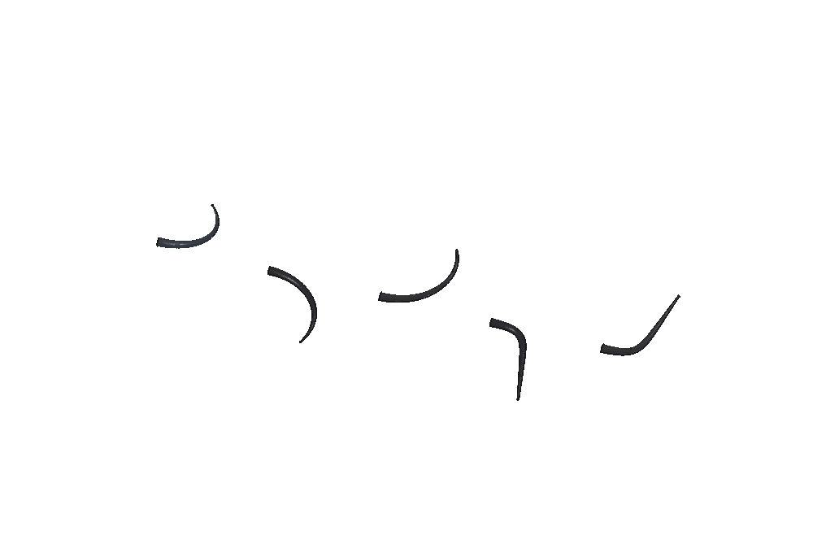
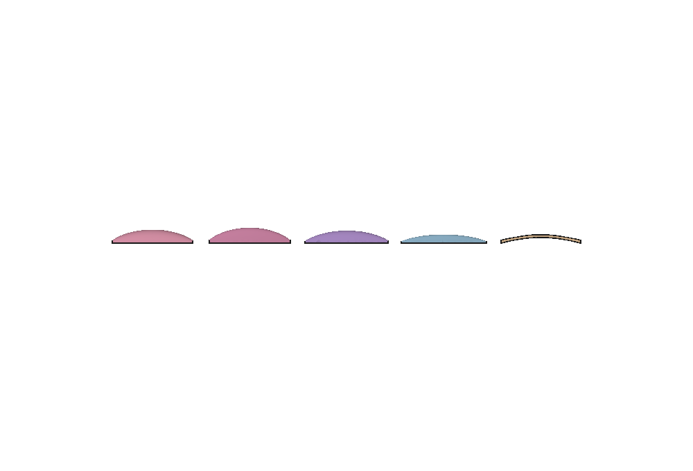
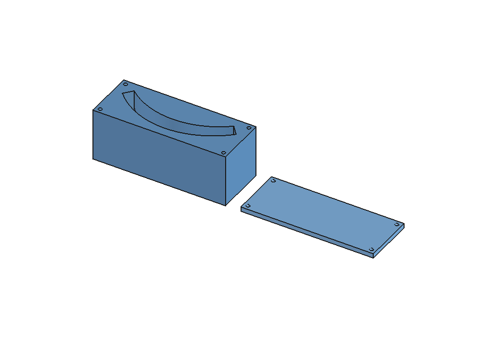
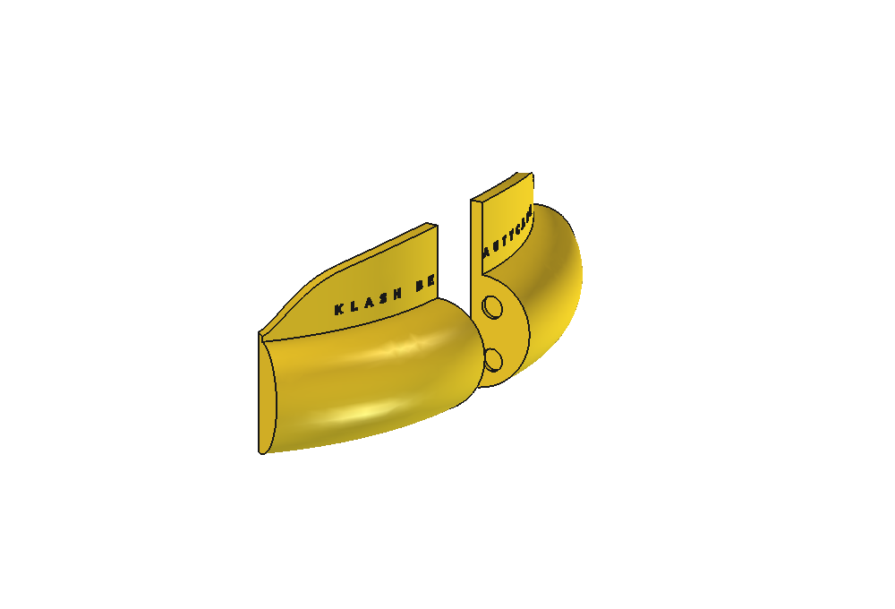

# LaLume HeadSpa – Lash Lift 3D Printing Training Kit (v2 – Curved-Arch Anatomy)

Parametric FreeCAD models modeled after real salon **Lash Oasis** curved-arch 2-zone teaching shields (**Prusa CORE One** ready).

> **Tip:** Click any **`.stl`** link below to open GitHub's **interactive 3D viewer** right in your browser. Use the **`.step`** files for maximum curve precision in PrusaSlicer.

---

## Visual Overview

| Lashes (C-Curl + L/M-Curl) | 5 Giant Curved-Arch Shields (5.5×) |
| :---: | :---: |
|  |  |

| Side Profile Comparison (Round / Hybrid / Teardrop / Flat) | 2-Part Silicone Casting Mold |
| :---: | :---: |
|  |  |

---

## Models (Interactive 3D Preview & STEP Downloads)

### 1. Enlarged Teaching Lashes (`150 mm` arc, `12.0 → 1.8 mm`)
| Part | Interactive 3D View (GitHub) | Precision Slicing | Notes |
| :--- | :---: | :---: | :--- |
| Flexible C-Curl Lash (TPU) | [Lash_Flexible_TPU.stl](stl/Lash_Flexible_TPU.stl) | [Lash_Flexible_TPU.step](step/Lash_Flexible_TPU.step) | `2.4 mm` internal wire channel (`≥ 1.2 mm` wall) for `2.0 mm` aluminum/copper wire |
| Split C-Curl Half A (Matte PLA) | [Lash_Solid_Half_A.stl](stl/Lash_Solid_Half_A.stl) | [Lash_Solid_Half_A.step](step/Lash_Solid_Half_A.step) | Flat cut face on `Z = 0`, 3 × `1.85 mm` pin holes |
| Split C-Curl Half B (Matte PLA) | [Lash_Solid_Half_B.stl](stl/Lash_Solid_Half_B.stl) | [Lash_Solid_Half_B.step](step/Lash_Solid_Half_B.step) | Mirror half, flat cut face on `Z = 0` |
| Split L/M-Curl Half A (Matte PLA) | [Lash_LM_Curl_Half_A.stl](stl/Lash_LM_Curl_Half_A.stl) | [Lash_LM_Curl_Half_A.step](step/Lash_LM_Curl_Half_A.step) | Flat root bend + straight upright shaft (matches Hybrid shield!) |
| Split L/M-Curl Half B (Matte PLA) | [Lash_LM_Curl_Half_B.stl](stl/Lash_LM_Curl_Half_B.stl) | [Lash_LM_Curl_Half_B.step](step/Lash_LM_Curl_Half_B.step) | Mirror half, flat cut face on `Z = 0` |

### 2. Giant 5.5× Curved-Arch Lash Lift Shields (2-Zone Anatomy, Upright `Z = 0` Base)
| Profile | Interactive 3D View (GitHub) | Precision Slicing | Dimensions (mm) |
| :--- | :---: | :---: | :--- |
| Classic Round (C-curl) | [Shield_Round.stl](stl/Shield_Round.stl) | [Shield_Round.step](step/Shield_Round.step) | `198.9 × 58.1 × 82.0` |
| Hybrid / Anatomical (L/M lift) | [Shield_Hybrid.stl](stl/Shield_Hybrid.stl) | [Shield_Hybrid.step](step/Shield_Hybrid.step) | `201.0 × 58.2 × 85.0` |
| Teardrop (D-curl) | [Shield_Teardrop.stl](stl/Shield_Teardrop.stl) | [Shield_Teardrop.step](step/Shield_Teardrop.step) | `203.0 × 62.1 × 85.0` |
| Flat (Korean Step 1 / L-curl) | [Shield_Flat_Korean.stl](stl/Shield_Flat_Korean.stl) | [Shield_Flat_Korean.step](step/Shield_Flat_Korean.step) | `197.5 × 50.4 × 95.0` |
| Arch-Matched Compensator Strip | [Shield_Compensator.stl](stl/Shield_Compensator.stl) | [Shield_Compensator.step](step/Shield_Compensator.step) | `170.5 × 29.5 × 30.0` |

### 2B. Magnetic Split-in-Half Shields (For Live Cross-Section Demos)
Split cleanly down `X = 0` (between letters, zero sliced characters) with **2 × `Ø 10.2 × 2.2 mm` magnet pockets per half** sized for **Unimagnet `KT-10-02-N` (`Ø 10 × 2 mm`, 1.3 kg pull)** neodymium disc magnets (4 magnets per shield, 16 total).

| Profile | Left Half (`STL` / `STEP`) | Right Half (`STL` / `STEP`) |
| :--- | :---: | :---: |
| Classic Round | [STL](stl/Shield_Round_Split_L.stl) · [STEP](step/Shield_Round_Split_L.step) | [STL](stl/Shield_Round_Split_R.stl) · [STEP](step/Shield_Round_Split_R.step) |
| Teardrop | [STL](stl/Shield_Teardrop_Split_L.stl) · [STEP](step/Shield_Teardrop_Split_L.step) | [STL](stl/Shield_Teardrop_Split_R.stl) · [STEP](step/Shield_Teardrop_Split_R.step) |
| Flat (Korean / L-curl) | [STL](stl/Shield_Flat_Korean_Split_L.stl) · [STEP](step/Shield_Flat_Korean_Split_L.step) | [STL](stl/Shield_Flat_Korean_Split_R.stl) · [STEP](step/Shield_Flat_Korean_Split_R.step) |
| Hybrid (Slanted Ramp) | [STL](stl/Shield_Hybrid_Split_L.stl) · [STEP](step/Shield_Hybrid_Split_L.step) | [STL](stl/Shield_Hybrid_Split_R.stl) · [STEP](step/Shield_Hybrid_Split_R.step) |

### 3. 2-Part PLA Silicone Casting Mold (Curved-Arch Hybrid Shield, Zero Undercuts)
| Part | Interactive 3D View (GitHub) | Precision Slicing | Notes |
| :--- | :---: | :---: | :--- |
| Mold Part A (Cavity Block) | [Shield_Mold_PartA.stl](stl/Shield_Mold_PartA.stl) | [Shield_Mold_PartA.step](step/Shield_Mold_PartA.step) | `233.0 × 90.2 × 91.0 mm`, 4 corner key recesses, `8 mm` pour funnel + 2 × `2.5 mm` air vents |
| Mold Part B (Flat Base Lid) | [Shield_Mold_PartB.stl](stl/Shield_Mold_PartB.stl) | [Shield_Mold_PartB.step](step/Shield_Mold_PartB.step) | `233.0 × 90.2 × 11.0 mm`, 4 protruding hemispherical alignment keys (`6.0 mm`) |

---

## Parametric CAD Source
- [LaLume_Lash_Training_Kit.FCStd](cad/LaLume_Lash_Training_Kit.FCStd) (FreeCAD 1.1.4 document with `Parameters` spreadsheet)
- [generate_models.py](cad/generate_models.py) (parametric FreeCAD Python generator)

## Prusa CORE One Slicing Notes
- **Curved-Arch Shields (Matte PLA):** Stand upright on the flat `Z = 0` bottom edge with a `5 mm` brim, `0.15–0.20 mm` layers (or Variable Layer Height), 3 perimeters, 10–15% Gyroid infill.
- **Split PLA Lashes (C-Curl & L/M-Curl):** Already oriented with flat cut face on `Z = 0` — drop straight onto the bed, `0.12 mm` layers, glue halves with short `1.75 mm` filament pins.
- **Silicone Mold (PLA):** `0.12 mm` layers, 3–4 perimeters, clamp tightly and apply mold release before pouring 2-part silicone.
- **TPU Flexible Lash:** Always apply glue stick (Kores / Magigoo) to PEI sheet before printing TPU.
